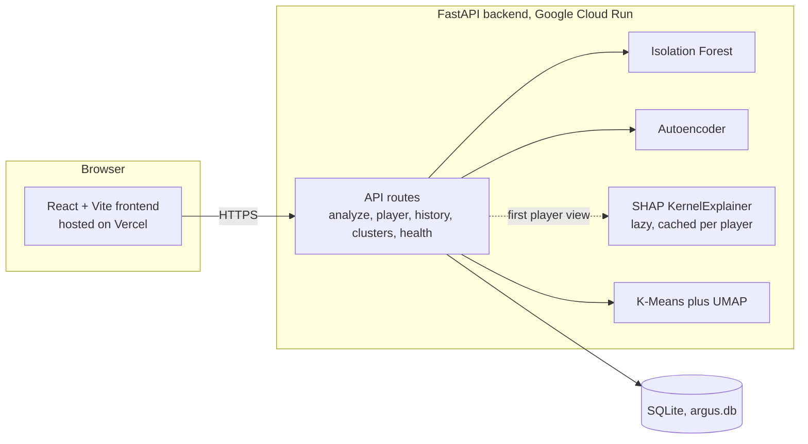
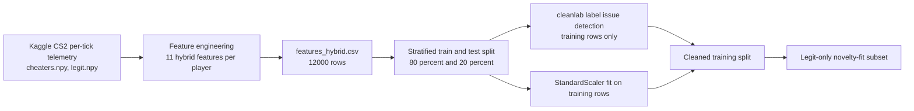
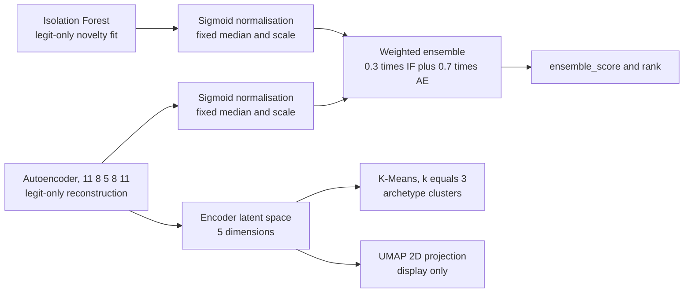
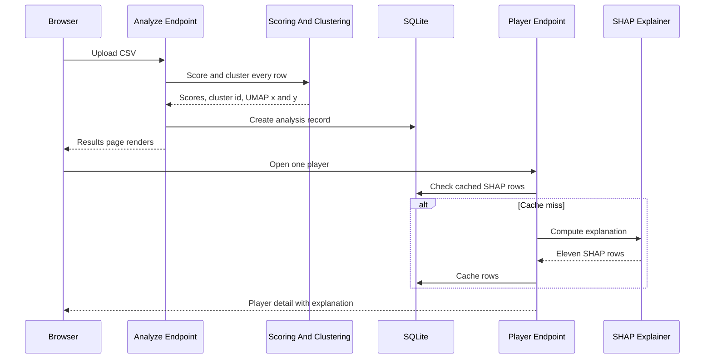
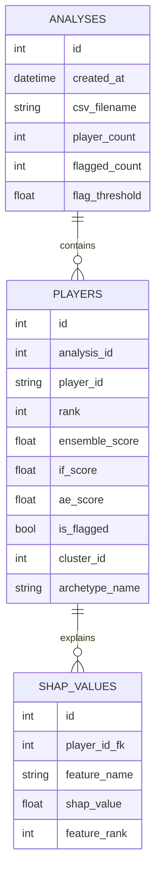
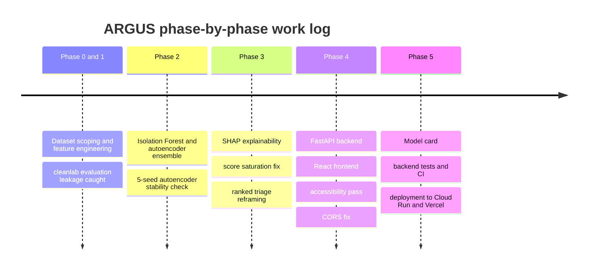

# ARGUS

[](https://github.com/Sriharinesh-Sureshkumar/ARGUS/actions/workflows/ci.yml)

**A**nomaly **R**ecognition and **G**ame **B**ehaviour **U**nderstanding **S**ystem — upload a CSV of per-player CS2 behaviour features and get back a ranked, explainable suspicion triage list, not a verdict.

**Live demo: [argus-gamma-puce.vercel.app](https://argus-gamma-puce.vercel.app)**

## Table of contents

- [Overview](#overview)
- [Screenshots](#screenshots)
- [How it works](#how-it-works)
  - [3.1 System architecture](#31-system-architecture)
  - [3.2 Data and feature pipeline](#32-data-and-feature-pipeline)
  - [3.3 Training and scoring](#33-training-and-scoring)
  - [3.4 Request flow](#34-request-flow)
  - [3.5 Database](#35-database)
- [Tools and why each was chosen](#tools-and-why-each-was-chosen)
- [Key design decisions](#key-design-decisions)
- [Results and honest evaluation](#results-and-honest-evaluation)
- [Problems faced and how they were solved](#problems-faced-and-how-they-were-solved)
- [Work log](#work-log)
- [What I learned](#what-i-learned)
- [How this was built](#how-this-was-built)
- [Limitations and future work](#limitations-and-future-work)
- [Project reference](#project-reference)
  - [Repository layout](#repository-layout)
  - [Run locally](#run-locally)
  - [Tests and CI](#tests-and-ci)
  - [Deployment](#deployment)
  - [Project docs index](#project-docs-index)

## Overview

ARGUS takes a CSV of per-player CS2 aim/firing-behaviour features and scores every player with a **suspicion score** between 0 and 1, then ranks them. Each player's rank can be opened for a **SHAP-based plain-language explanation** of why their score is what it is, and players are grouped into three behavioural **archetype clusters**, visualised on a 2-D UMAP map. Past uploads are kept in **History**, with delete.

**Who it's for**: someone reviewing a batch of players (an admin, an analyst) who wants a prioritised list of "who to look at first," with evidence attached to each entry — not an automated decision-maker.

**What ARGUS is NOT**:

- **Not a verdict.** It produces a suspicion score and a rank for human review. Nothing in its output is proof that a player cheated.
- **Not an automated-ban system.** There is no enforcement action anywhere in this codebase.
- **Not a single-match analyser.** Scores are computed from aggregate features across a fixed window of 30 engagements per player, not one match or one engagement in isolation.
- **Not a `.dem` parser.** ARGUS consumes a pre-computed feature CSV only; parsing raw CS2 demo files is unbuilt future work (see [Limitations and future work](#limitations-and-future-work)).

This is a demo deployment. History resets whenever the backend restarts or scales to zero. The first request after the backend has been idle can take 15 to 30 seconds (cold start). The demo CSV rows (`sample_data/demo_players.csv`) are sampled directly from the model's own training data, so scores on them demonstrate the app working, not model performance — see [Results and honest evaluation](#results-and-honest-evaluation).

## Screenshots

| | |
|---|---|
|  Upload — idle state, drag-and-drop a CSV |  Processing — upload progress and a processing skeleton |
|  Results — podium plus a searchable, sortable, paginated table |  Player detail — score ring, SHAP explanation, UMAP position |
|  Clusters — archetype cards and a UMAP scatter plot |  History — past analyses, sortable, with delete |
|  Delete confirmation dialog |  A plain-language error panel |

## How it works

### 3.1 System architecture



The browser talks to a FastAPI backend over HTTPS. The backend loads every model artifact once at startup, scores and clusters uploaded players in-process, computes SHAP explanations lazily (only when a player's detail page is first opened, then caches the result), and stores everything in a single SQLite file inside its own container. The frontend is a static site; the backend is a container, currently Google Cloud Run (see [Deployment](#deployment)).

### 3.2 Data and feature pipeline



The source data is a pre-processed Kaggle dataset of per-tick CS2 behaviour telemetry: `cheaters.npy` (2,000 players) and `legit.npy` (10,000 players), each with 30 engagements of up to 192 ticks. A second dataset, CS2CD (Hugging Face), was evaluated and rejected during scoping — see [Problems faced](#problems-faced-and-how-they-were-solved). Each player's 30 engagements are aggregated into 11 features (max/min for "peak"-style features, mean for the rest):

| Feature | Meaning |
|---|---|
| `peak_yaw_delta` | Largest single-tick horizontal aim snap, degrees |
| `peak_pitch_delta` | Largest single-tick vertical aim snap, degrees |
| `mean_yaw_delta` | Average horizontal aim movement per tick, degrees |
| `snap_count` | Count of sudden aim snaps during the engagement |
| `min_cv_yaw` | Closest horizontal approach to the target, degrees |
| `min_cv_pitch` | Closest vertical approach to the target, degrees |
| `cv_yaw_std` | Std. dev. of horizontal aim-to-target distance, degrees |
| `cv_pitch_std` | Std. dev. of vertical aim-to-target distance, degrees |
| `fire_on_target_rate` | Share of shots fired while aimed within 2° of the target |
| `yaw_jerk` | Average horizontal jerk (rate of change of aim speed), °/tick² |
| `engagement_firing_rate` | Share of ticks during the engagement with a shot fired |

The resulting 12,000-row feature table (10,000 legit / 2,000 cheater, 16.67%/83.33%) is split 80/20 (stratified, `random_state=42`) into train/test. `cleanlab`'s label-issue detection runs on the training split only — the test split is never touched by cleaning — and flagged rows are removed from training only. Both the Isolation Forest and the autoencoder are then fit on the **legit-only** subset of that cleaned training split (a novelty-detection fit, not a mixed one).

### 3.3 Training and scoring



An Isolation Forest and an 11→8→5→8→11 PyTorch autoencoder are both trained only on legit-labelled rows. Each model's raw score is passed through a sigmoid fixed at training time (median/scale constants baked into `backend/trained_models/scoring_config.json`, not recomputed per upload), then combined as `ensemble_score = 0.3 * if_score + 0.7 * ae_score`. Separately, the autoencoder's 5-dimensional latent space feeds a K-Means (k=3) archetype clustering and a UMAP 2-D projection used only for the Clusters page scatter plot — clustering and UMAP play no part in the suspicion score itself.

### 3.4 Request flow



`POST /analyze` validates, scores, clusters, and stores every row in one synchronous request — SHAP is deliberately **not** computed here, since doing so made uploads ~2.5s/player. The first `GET /player/{id}` for a given player computes its 11 SHAP values once (a few seconds) and caches them in the database; every later view of that same player is a cache read. All six endpoints are under `/api/v1`:

| Method | Path | Purpose |
|---|---|---|
| GET | `/health` | Model/DB readiness check |
| POST | `/analyze` | Upload a CSV, create an analysis |
| GET | `/history` | List past analyses, newest first |
| GET | `/history/{analysis_id}` | Reload one analysis |
| DELETE | `/history/{analysis_id}` | Delete an analysis and its players/SHAP rows |
| GET | `/player/{player_id}?analysis_id=` | One player's scores plus SHAP explanation |
| GET | `/clusters?analysis_id=` | Per-archetype summaries plus every player's UMAP point |

Every rejection ARGUS raises itself is a 4xx with a plain-language `{code, message, fix}` body: `wrong_file_type`, `file_too_large`, `unreadable_csv`, `no_rows`, `too_many_rows`, `missing_columns`, `invalid_player_id`, `invalid_values`, `duplicate_player_ids` (`backend/api/routes/analyze.py`). `analysis_not_found`/`player_not_found`/`no_analyses` cover the lookup routes.

### 3.5 Database



One `Analysis` (one CSV upload) has many `Player` rows (one per uploaded player), and each `Player` has up to 11 `SHAPValue` rows (one per feature, populated lazily). Deleting an `Analysis` cascades through the ORM relationships (`cascade="all, delete-orphan"` on both edges) — verified directly against the database that deleting an analysis leaves zero orphaned `players` or `shap_values` rows.

## Tools and why each was chosen

| Tool | Used for | Why this (not an alternative) | Version |
|---|---|---|---|
| Python + uv | Backend language and dependency/environment management | `uv` is the project's package manager throughout (`uv.lock`, `uv sync`); no comparison against pip/Poetry is recorded | Python ≥3.11; uv 0.11.20 observed in use |
| PyTorch | Autoencoder implementation and training | Project's deep-learning framework; no alternative (e.g. TensorFlow) comparison recorded | torch ≥2.12.0 (2.14.1+cpu in the deployment container) |
| scikit-learn | Isolation Forest, StandardScaler, K-Means, and the Random Forest diagnostic reference model | No alternative-toolkit comparison recorded; used for every classical ML component | 1.9.0 (pinned exactly in the deployment container to match the committed model pickles) |
| cleanlab | Detects likely-mislabelled training rows via cross-validated prediction confidence | Chosen specifically to test whether label noise explained the unsupervised AUC ceiling — found a measured +0.017 AUC impact, not the primary cause. Training-only; moved to an optional dependency, not installed at runtime | ≥2.9.0 |
| SHAP | Per-player explanation of `ensemble_score` in terms of the 11 input features | Needed a plain-language, per-feature explanation for human review; cross-checked against a TreeExplainer surrogate for trustworthiness | ≥0.51.0 |
| UMAP (umap-learn) | 2-D projection of the autoencoder's latent space for the Clusters page scatter plot | Added to close a visualisation gap in the original plan; display only, no alternative comparison recorded | ≥0.5.12 |
| FastAPI | Backend web framework serving the 6 REST endpoints | No alternative-framework comparison recorded | ≥0.141.1 |
| SQLAlchemy + SQLite | ORM and storage for analyses/players/SHAP values | SQLite specifically: "single-operator local tool, no concurrent users, no cloud deployment. Supabase adds an external-dependency risk" | SQLAlchemy ≥2.0.54 |
| Pydantic | Request/response schema validation, the standard `{code, message, fix}` error shape | Ships with FastAPI; no separate comparison recorded | bundled with FastAPI |
| React + Vite + Tailwind CSS | Frontend framework, build tool, styling | React: "full visual control for demo day; Streamlit's visual ceiling too low." Vite/Tailwind: scaffolded from the official Vite React template; no alternative comparison recorded for either | react ^19.2.8, vite ^8.3.0, tailwindcss ^4.3.3 |
| axios | HTTP client for `POST /analyze` | Exposes real per-request upload-progress events (`onUploadProgress`); the plain `fetch()` used elsewhere has no equivalent for a request body | ^1.20.0 |
| pytest + httpx | Backend test runner | Standard Python testing framework; `httpx` added alongside it because FastAPI's `TestClient` requires it | pytest ≥9.1.1, httpx ≥0.28.1 |
| GitHub Actions | CI: backend pytest, frontend lint and build, on every push/PR to `main`/`build` | No alternative CI provider comparison recorded | `.github/workflows/ci.yml` |
| Docker | Container format for the backend | Required by Hugging Face Spaces' Docker SDK option, the original deployment target; the same Dockerfile and staged build were reused unchanged once Cloud Run replaced it | `python:3.11-slim` base |
| Google Cloud Run | Hosts the live backend | Hugging Face Docker Spaces turned out to require a paid plan; Cloud Run was used instead, reusing the same staged Docker build unchanged | service `argus-api`, `us-central1` |
| Vercel | Hosts the live frontend static site | No alternative-host comparison recorded; used for static hosting with build-time env vars and SPA rewrite support | — |

## Key design decisions

1. **Novelty fit on legit-only data, not a mixed fit.** Isolation Forest and the autoencoder are trained only on legit-labelled rows. *Why*: a legit-only novelty fit measured AUC 0.5866 versus a mixed fit's 0.5784 at the player level. *Trade-off*: the models never see a cheater example during training, so they can only flag "unusual relative to legit players," not learn what cheating specifically looks like — this mirrors real deployment, where reliable cheat labels don't exist.

2. **Player-level feature aggregation, not engagement-level.** *Why*: engagement-level unsupervised detection scored AUC 0.50–0.53 (near-random) under both a mixed fit and a legit-only novelty fit, showing the problem was granularity, not fitting strategy. *Trade-off*: label dilution — a cheater's label is applied uniformly across all 30 of a player's engagements even though the cheat behaviour is unlikely to be active in all of them; this is a structural, unresolved limitation of the training data.

3. **Fixed-reference sigmoid normalisation, not per-upload recomputation.** *Why*: scores need to be comparable across different uploads, and a fixed reference fixed a prior bug where hard-clipping made true and false positives indistinguishable at the score ceiling. *Trade-off*: inputs far outside the training distribution can still push toward (though, after the fix, rarely exactly reach) a ceiling score without that implying certainty.

4. **Lazy, cached SHAP computation, not eager.** *Why*: eager SHAP on every player during `/analyze` made an 8-player upload take 20.02s (2.50s/player) — unacceptable for realistic batch sizes. *Trade-off*: the first view of each player's detail page is slow (a few seconds); concurrent requests for the same uncached player originally raced and duplicated cache rows, requiring explicit locks to fix (see [Problems faced](#problems-faced-and-how-they-were-solved)).

5. **Ranked triage, not binary flagging.**

   ```mermaid
   flowchart TD
       A["Binary flag at threshold 0.5"] --> B["Precision only 0.209<br/>4 of 5 flagged players are false positives"]
       B --> C["High-precision threshold 0.8275<br/>recall drops to 0.07"]
       C --> D["Neither threshold is safe<br/>for an automated flag"]
       D --> E["Reframed as a ranked suspicion score<br/>for human review"]
   ```

   *Why*: at the F1-optimal threshold, precision was only 0.209; the high-precision alternative only reached 0.40 precision at 0.07 recall. Neither is acceptable for a binary "flagged = accusation" system. *Trade-off*: requires a human reviewer to look at ranked, explained evidence rather than giving a simple automated answer — `is_flagged` is kept only as a secondary indicator.

6. **SQLite, not PostgreSQL/Supabase.** *Why*: "single-operator local tool, no concurrent users, no cloud deployment. Supabase adds an external dependency risk." *Trade-off*: in the live deployment, history lives inside the backend container's own filesystem, so it is wiped on every restart, redeploy, or scale-to-zero.

7. **React, not Streamlit.** *Why*: "full visual control for demo day; Streamlit's visual ceiling too low." *Trade-off*: considerably more implementation work — routing, state machines, design tokens, and a full accessibility pass — than a Streamlit app would have needed.

8. **A committed SHAP background artifact, not recomputed at startup.** *Why*: the backend previously loaded 7 training-data files unconditionally at every startup just to build a 100-row SHAP background sample, and a clean clone failed outright because those files are gitignored. *Fix*: a script precomputes the same deterministic sample once and commits an 8.7 KB artifact instead. *Trade-off*: the artifact must be regenerated and recommitted if the training data or cleaning method ever changes.

9. **`cleanlab` as an optional dependency, not a runtime one.** *Why*: it was only used by the training-only data-cleaning path, but was imported at module level, so every backend startup paid for an import that only a bypassable training path used — and it wasn't even declared in the lockfile, so a fresh install couldn't find it at all. *Trade-off*: anyone wanting to retrain or rebuild the cleaned split needs the optional `train` extra installed first.

## Results and honest evaluation

Full detail, every number cited to its source file, is in [`docs/MODEL_CARD.md`](docs/MODEL_CARD.md). Summary:

- **Deployed ensemble AUC-ROC: 0.6033** (later re-measured at 0.6035 after a monotonic normalisation fix — the actually-running production code's number, a noise-level difference from 0.6033).
- **Supervised reference ceiling: AUC 0.6745** (a Random Forest trained on the same cleaned features — diagnostic only, never deployed; shown to illustrate what a label-aware model could reach on the same data).
- **Individual deployed models**: Isolation Forest alone 0.5941, autoencoder alone 0.5786 (same test set, percentile-normalised).

| Threshold | Precision | Recall | F1 | Flagged | False positives |
|---|---|---|---|---|---|
| 0.50 (default, F1-optimal) | 0.2090 | 0.6475 | 0.3160 | 1,239 | 980 |
| 0.8275 (high-precision alternative) | 0.4000 | 0.0700 | 0.1191 | 70 | 42 |

**No separate validation set was used** for any hyperparameter sweep or the threshold search above — every one was evaluated directly against the same untouched 2,400-row test set. The only validation split anywhere in the pipeline is the autoencoder's internal 90/10 split of its own legit-only training rows, used solely for early stopping. This means the reported numbers may be optimistically biased by repeated evaluation against the same test set — a visible methodological caveat, not a hidden one.

**Archetype cluster separation is small**: on a real (non-training-saturated) 124-player analysis, the average `ensemble_score` spread across the three clusters was 0.073 (0.584 high − 0.511 low) — archetypes describe playing style, not suspicion level.

**SHAP findings**: `min_cv_pitch` (closest vertical approach to the target) dominates feature importance by roughly 9–15x over the next feature, confirmed independently by both `KernelExplainer` and a `TreeExplainer` cross-check. A feature-ablation test found `min_cv_pitch` alone captures 96% of the full model's AUC, but its score correlation with the full 11-feature model is only 0.64 — meaning the other 10 features change *which* players get flagged, not just by how much, so all 11 were kept in production.

## Problems faced and how they were solved

| Problem | What happened | Root cause | Fix | Lesson |
|---|---|---|---|---|
| CS2CD dataset turned out unlabelled | A second candidate dataset (Hugging Face) was inspected directly during scoping | It was raw, unlabelled, ~735M-row per-tick telemetry, not the pre-windowed labelled dataset its source paper described, with no usable cheat labels in the public repo | Rejected entirely; used the Kaggle dataset instead | Inspect a dataset directly before committing to it, even when its paper describes something else |
| cleanlab evaluation leakage | Cleaning + a fresh train/test re-split pushed AUC to 0.8820 | The fresh re-split removed the model's hardest cases from the *test* set too, inflating the score artificially | Re-ran with flagged rows removed from training only, test set left untouched → real AUC 0.6745 | A sudden metric jump that breaks a consistent pattern across many prior experiments is a signal to re-check the evaluation, not a result to celebrate |
| Autoencoder lucky seed | A single training run reached AUC 0.6003, picked as the production model | Re-training with 5 different seeds (otherwise identical config) gave a range of 0.5699–0.6003, mean 0.5819 — the adopted run was a high outlier, 1.45 std devs above the mean | Replaced the deployed checkpoint with the seed closest to the 5-seed mean (0.5786) | A single training run's metric can be a lucky draw; check seed variance before trusting it |
| Score saturation | Hard-clipping raw scores to [0,1] made two "flagged" players indistinguishable at a tied score of exactly 1.0 — one was a true cheater, the other legit | The clip function saturated extreme scores to the exact boundary, discarding information about *how* extreme they were | Replaced with a smooth sigmoid transform (fixed median/scale); AUC unchanged (monotonic transform) but scores no longer tie at the ceiling | A score calibration choice can silently destroy the information a human reviewer needs, even with identical AUC |
| UMAP cold-start misdiagnosis | An apparent "~0.73s/player" clustering cost was initially attributed to per-player clustering work | Profiling found it was actually a one-time ~6.5s UMAP/Numba JIT compilation cost on the *first* `transform()` call per server process, not a per-player cost at all | Added a dummy warmup request through the full pipeline at server startup, paying the JIT cost before any real request arrives; real per-request cost dropped to ~0.058s for 8 players | A plausible-sounding cost attribution can be wrong; profile before optimizing the thing you assumed was slow |
| SHAP thread-safety and duplicate rows | Concurrent requests for different never-cached players crashed with an `IndexError` inside SHAP's internals; concurrent requests for the *same* never-cached player both computed and both wrote, doubling the cached rows | SHAP's `KernelExplainer` mutates shared internal state with no locking of its own; the cache check-then-write sequence had no lock around it either | Added two `threading.Lock`s: one serialising calls into the shared explainer, one around the whole check-cache/compute/write-cache sequence | Concurrency bugs in a "single-admin local tool" can still surface the moment a real browser issues two requests close together (e.g. React StrictMode's double effect-invoke) |
| Engagement-level detection near-random | Scoring each of 360,000 individual engagements independently (instead of aggregating per player) scored AUC 0.50–0.53 under both a mixed fit and a legit-only novelty fit | Unsupervised detection at this granularity flags any statistically unusual engagement, not specifically cheating-related unusualness — real cheat signal gets buried in irrelevant behavioural variance | Rejected; moved to player-level aggregation (adopted architecture) | Finer granularity isn't automatically better for unsupervised anomaly detection — it can dilute the signal you're after |
| Clean-clone failures | A fresh `git clone` + `uv sync` installed cleanly, but the backend crashed on startup with `ModuleNotFoundError: No module named 'cleanlab'`, and after installing it by hand, crashed again with `FileNotFoundError` for a training-data file | `cleanlab` was imported at module level but never declared in `pyproject.toml`/`uv.lock` (silently present only in the development environment); a startup code path unconditionally loaded 7 gitignored training-data files just to build a SHAP background sample | Declared `cleanlab` as an optional `train` dependency and made the import lazy; precomputed and committed the one small SHAP-background artifact the backend actually needs, removing the startup dependency on the large training files entirely | A repo that only works in the environment that built it isn't finished — a clean-clone test catches dependency and data-file gaps nothing else will |
| Hardcoded CORS | A clean-clone verification run on a non-default frontend port failed every page past the upload step with a browser CORS error | `backend/main.py` hardcoded `allow_origins=["http://localhost:5173"]` — any frontend not on exactly that origin was silently rejected by the browser | Added a `CORS_ORIGINS` environment variable (comma-separated, safe localhost default, never `*`), read at startup | A hardcoded default that works in dev can silently break the moment the app runs anywhere else — needed before any real deployment could work at all |
| Accessibility contrast violations | A manual WCAG contrast audit and an automated `axe-core` run both found the same failures independently | The muted-text colour token failed the 4.5:1 text-contrast threshold against several real backgrounds it was actually used on (as low as 3.24:1 against the worst one) | Raised the token's lightness to the minimum value that cleared the *worst* real background it appears on, not just the obvious ones; fixed one component-level text/background mismatch without changing any token value | Check contrast against every background a colour is *actually* used on, not just the three or four most obvious ones |
| Cloud Build IAM failure | `gcloud run deploy --source` failed with a bare `PERMISSION_DENIED` that didn't name a missing role | On a new GCP project, the default Cloud Build service account lacks the IAM roles needed to build and push a container image, and the error doesn't say so | Granted the service account `cloudbuild.builds.builder`, `storage.objectAdmin`, `artifactregistry.writer`, and `logging.logWriter` once per project | A bare `PERMISSION_DENIED` from a managed build service can mean a missing one-time IAM grant, not a code problem |
| Hugging Face Docker Spaces require a paid plan | A backend container was fully built and staged for a Hugging Face Space (Docker SDK), only to discover at Space-creation time that Docker Spaces are a paid feature | Not checked before building the deployment artifact | Dropped Hugging Face as the backend host; reused the identical staged folder and Dockerfile, unchanged, to deploy to Google Cloud Run instead | Confirm a hosting platform's pricing tier for the specific SDK/feature you need *before* building the deployment artifact for it |

## Work log



| Phase | What was done | Outcome |
|---|---|---|
| 0 | Project scoping, repo structure, dataset selection | React over Streamlit, SQLite over Supabase, CS2CD dataset rejected |
| 1.1–1.3 | EDA, two rejected feature-aggregation schemes, final hybrid feature set | 11-feature hybrid set adopted |
| 1.3.5–1.4.5 | Early-engagement features, LightGBM, engagement-level detection | All three tested and rejected |
| 1.5 | Player-level, legit-only Isolation Forest | Adopted as the real ARGUS architecture |
| 1.6/1.6.5 | cleanlab label-noise check | Caught an evaluation-leakage bug (0.8820 → corrected 0.6745) |
| 1.7 | Four new feature types tested | Rejected, no improvement over the 11-feature set |
| 2.1–2.3 | Isolation Forest + autoencoder ensemble, hyperparameter tuning, 5-seed stability check | Production ensemble finalised (AUC 0.6033), lucky-seed outlier corrected |
| 3.1/3.1.5/3.1.6 | Production scoring function, SHAP integration, SHAP cross-check, feature ablation | `min_cv_pitch` dominance confirmed; all 11 features kept |
| 3.2 | Fixed hard-clip score saturation, established the production threshold | Smooth sigmoid normalisation; 0.50 default threshold |
| 3.3 | Product reframing | Ranked triage adopted instead of binary flagging |
| 3.4 | K-Means + UMAP clustering | Three archetype clusters added |
| 4.1–4.1.9 | FastAPI backend: endpoints, DB models, lazy SHAP, startup warmup, hardened error contract | Backend ready for the frontend |
| 4.2.0–4.2.6 | React frontend built page by page (Upload, Results, Player Detail, Clusters, History), then an accessibility/polish pass | Full UI complete, WCAG contrast and `axe-core` violations fixed |
| 4.3/4.3b | Backend cleanup, clean-clone test | Found and fixed the `cleanlab`/missing-data-file startup failures |
| 4.4 | README, docs, screenshots | First public-facing documentation written |
| 4.5/4.5b | Verification of the pushed branch | Found and fixed hardcoded CORS |
| 5.1 | Model card | `docs/MODEL_CARD.md` written, every fact cited |
| 5.2 | Backend tests + CI | 24 tests, GitHub Actions workflow |
| 5.3 | Deployment files prepared (Hugging Face Space + Vercel) | Not deployed yet; Docker unavailable locally, verified via a clean venv instead |
| 5.4 | Real deployment | Hugging Face dropped (paid plan required); deployed to Cloud Run + Vercel instead |
| 5.5 | This README rewrite | Reorganised into the structure you're reading now |

<!-- Owner: review and edit these in your own words -->
## What I learned

- **Evaluation hygiene matters more than model choice.** The single highest-value catch in this whole project was a data-leakage bug in my own evaluation setup (the cleanlab re-split), not a modeling improvement — a result that breaks a consistent pattern across many prior experiments deserves suspicion before celebration.
- **A single training run's metric can be a lucky draw.** I only found this because I re-ran the autoencoder with five different seeds; without that check, I would have shipped an outlier and believed it was representative.
- **An honest low number is more useful than a hidden assumption.** A 0.60 AUC model is weak on its own, but knowing exactly how weak — and why — is what let me make the right product call (ranked triage, not binary flagging) instead of overselling a flag I couldn't back up.
- **Production concerns don't wait for production.** Cold starts and thread-safety races both showed up during local development the moment I exercised the app the way a real browser would (React's StrictMode double-invoke, a UMAP JIT warmup), not after deployment.
- **Cross-checking an explanation method against a second one is worth the time.** Confirming SHAP's `min_cv_pitch` dominance with an independent TreeExplainer surrogate turned a "this might be an artifact of the explanation method" worry into a confirmed finding about the data itself.
- **Scoping and deferring work explicitly is a decision, not a gap.** Choosing not to build the raw `.dem` parser (Path B) and documenting it as future work kept the project bounded without pretending the limitation doesn't exist.
- **A repo only works where it's been tested until you test it somewhere else.** A clean-clone test caught both a missing dependency declaration and a hidden data-file requirement that every single run in my own long-lived environment had silently papered over.
- **Deployment has its own lessons, separate from the model.** Checking a hosting platform's pricing tier before building for it, and knowing that a bare `PERMISSION_DENIED` from a managed build service usually means a missing one-time IAM grant, are things I only learned by hitting them.

## How this was built

This project was built by me, using Claude Code (an AI coding agent) under my direction. I wrote the specifications for each phase, made every product and architecture decision (the dataset, the feature set, the model choices, the ranked-triage reframing, the deployment path), and reviewed and tested each step myself — including catching several of the bugs described in [Problems faced](#problems-faced-and-how-they-were-solved) before they went further. All git commits in this repository were made by me.

## Limitations and future work

- **Low AUC means the score is a weak signal.** 0.60 AUC-ROC is above chance but far from a strong classifier; at the default threshold, 4 of 5 flagged players are false positives.
- **Out-of-range inputs can saturate near 1.0.** Scoring uses a sigmoid fixed to the training distribution; inputs far outside it can still push toward a ceiling score without that implying certainty.
- **The bundled demo scores are not evidence of anything.** `sample_data/demo_players.csv` is sampled directly from the model's own training data.
- **Archetype cluster separation is small** (0.073 average-score spread on a real analysis) — archetypes describe playing style, not suspicion level.
- **Label dilution.** A cheater's label applies uniformly across all 30 of a player's engagements even though the cheat behaviour is unlikely active in all of them — unresolved; engagement-level modelling was tested as a fix and failed outright.
- **Missing behavioural signal.** The dataset only captures 5 aim/firing channels — no wallhack-relevant signal (e.g. rotation toward not-yet-visible enemies) and no movement/positioning data.
- **Upload limits**: `.csv` only, 10 MiB, 5,000 rows per upload, both overridable via `ARGUS_MAX_UPLOAD_BYTES`/`ARGUS_MAX_ROWS`.
- **SQLite history is not persistent in the live deployment** — it is wiped on every container restart, redeploy, or scale-to-zero.

**Future work, not implemented:**

- **Raw `.dem` file parsing ("Path B")** — parsing raw CS2 demo files directly (e.g. with `awpy`/`demoparser2`) to engineer features from scratch, instead of relying on a pre-processed dataset. A legitimate, bounded extension; **not attempted** in this build, due to time/scope.
- **A richer, larger labelled dataset (recommended direction)** — one that includes wallhack-relevant signals, movement/positioning data, and ideally per-engagement cheat-activity labels rather than per-player labels applied uniformly. This directly targets the diagnosed bottleneck (missing information), unlike further modelling iteration on the current dataset.
- **Video-based computer vision (considered, not recommended)** — extracting aim/timing telemetry from gameplay video via OpenCV was considered and rejected: CS2 is a first-person 3D game, and reconstructing precise aim angles from 2D video frames is a much harder, largely unsolved problem — and unnecessary, since `.dem` files already provide this exact data as structured, ground-truth telemetry.

## Project reference

### Repository layout

```
ARGUS/
├── backend/
│   ├── api/             # FastAPI routes, Pydantic schemas, error shaping
│   ├── core/             # model.py, inference.py, clustering.py, explainer.py, config.py
│   ├── db/               # SQLAlchemy models, session, CRUD
│   ├── trained_models/   # committed model weights + the SHAP background artifact
│   ├── data/              # training fixtures (gitignored except via the export script)
│   ├── notebooks/         # Phase 1-3 research notebooks
│   └── tests/
├── frontend/
│   ├── src/
│   │   ├── pages/        # one file per route
│   │   ├── components/   # shared + page-scoped components
│   │   ├── api/           # backend client functions
│   │   ├── lib/           # pure helpers (dates, SHAP text parsing, cluster styling)
│   │   └── styles/        # tokens.css -- the only place colours are defined
│   └── public/
├── sample_data/          # demo_players.csv + its README
├── scripts/                # export_runtime_artifacts.py, build_space.py
├── deploy/hf-space/        # Dockerfile + requirements.txt, reused unchanged for Cloud Run
└── docs/
    ├── MODEL_CARD.md      # the model card
    ├── DEPLOYMENT.md      # exact deployment steps
    ├── PROJECT_LOG.md     # full phase-by-phase decision history
    ├── mockups/
    └── screenshots/
```

### Run locally

Requires Python ≥3.11 and [uv](https://docs.astral.sh/uv/), and Node for the frontend.

```bash
# Backend (from the repo root)
uv sync
uv run uvicorn main:app --reload --app-dir backend
# -> http://localhost:8000, GET /api/v1/health to check

# Frontend (separate terminal, from frontend/)
npm ci
npm run dev
# -> http://localhost:5173
```

Environment variables (both have a committed `.env.example`):

| Variable | Where | Default | Purpose |
|---|---|---|---|
| `VITE_API_BASE_URL` | `frontend/.env.local` | `http://localhost:8000/api/v1` | Where the frontend sends API requests (build-time only) |
| `LOG_LEVEL` | `backend/.env` or shell | `INFO` | `DEBUG` also logs per-request timing and SHAP cache hit/miss |
| `CORS_ORIGINS` | `backend/.env` or shell | `http://localhost:5173,http://127.0.0.1:5173` | Comma-separated origins the API accepts requests from |
| `ARGUS_DB_PATH` | `backend/.env` or shell | `./argus.db` | SQLite file path — overridable for a container's writable mount |

**Changing ports**: if the frontend runs anywhere other than `http://localhost:5173`, the backend will reject its requests with a CORS error unless `CORS_ORIGINS` is set to match.

**Try it**: on the Upload page, drop in [`sample_data/demo_players.csv`](sample_data/demo_players.csv) (124 rows — see the caveat in [Overview](#overview) and `sample_data/README.md`).

Training-only tooling (notebooks, retraining, `scripts/export_runtime_artifacts.py`) additionally needs `uv sync --extra train`.

### Tests and CI

Backend tests (`backend/tests/`) hit a real FastAPI `TestClient` against the real committed model artifacts — nothing is mocked — but every database read/write is redirected to a throwaway SQLite file; the real `backend/argus.db` is never opened.

```bash
uv sync
uv run pytest
```

Frontend checks:

```bash
cd frontend
npm ci
npm run lint
npm run build
```

Both suites run in CI on every push/PR to `main` and `build` (`.github/workflows/ci.yml`).

### Deployment

The live demo is deployed on Google Cloud Run (backend) and Vercel (frontend). Exact, reproducible steps — including the `gcloud` commands, one-time IAM grants, CORS configuration, and known limits — are in [`docs/DEPLOYMENT.md`](docs/DEPLOYMENT.md).

### Project docs index

- [`docs/MODEL_CARD.md`](docs/MODEL_CARD.md) — what the model was trained on, how it performs, and where it should not be trusted.
- [`docs/PROJECT_LOG.md`](docs/PROJECT_LOG.md) — the full phase-by-phase decision history this README is built from.
- [`docs/DEPLOYMENT.md`](docs/DEPLOYMENT.md) — exact steps to deploy the backend and frontend.

### Datasets and credits

Training data: a pre-processed Kaggle dataset of per-tick CS2 behaviour telemetry (see the dataset's own page for licensing — not recorded in this repo).

A second dataset, **CS2CD** (Hugging Face), was evaluated and excluded during initial scoping — see [Problems faced](#problems-faced-and-how-they-were-solved). See the dataset's own page for licensing.
