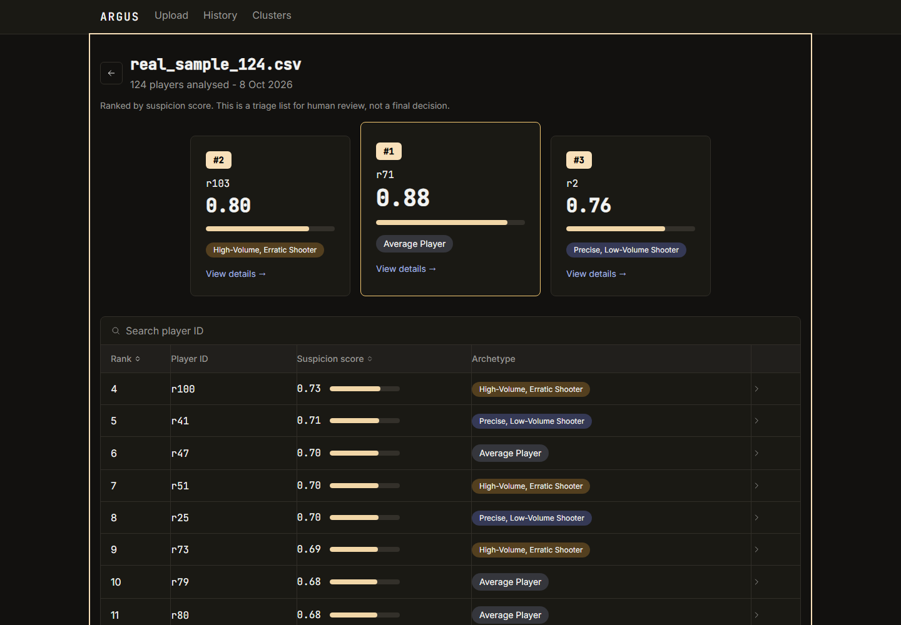
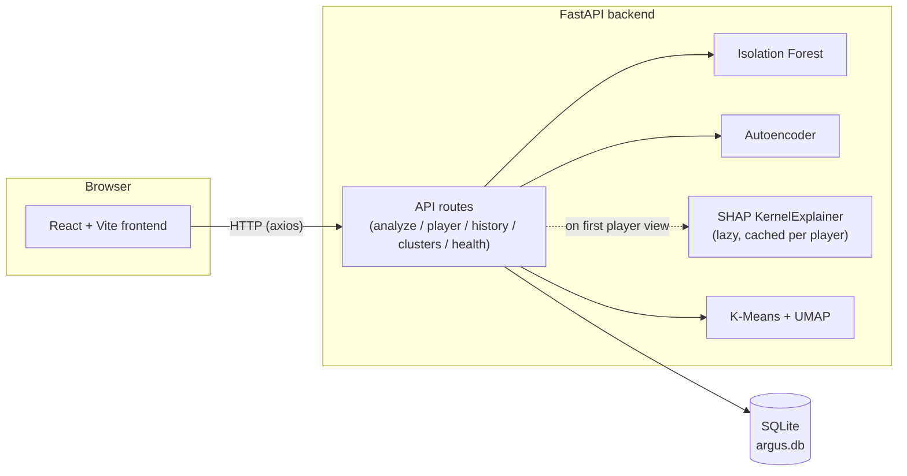
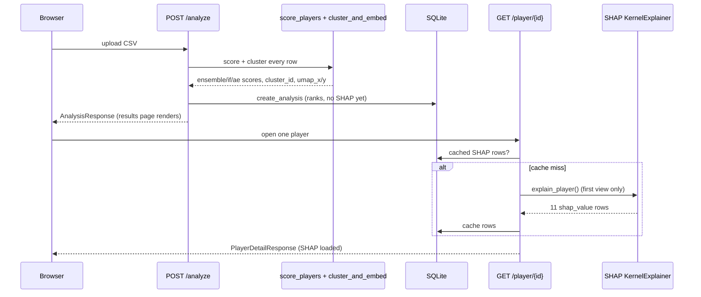
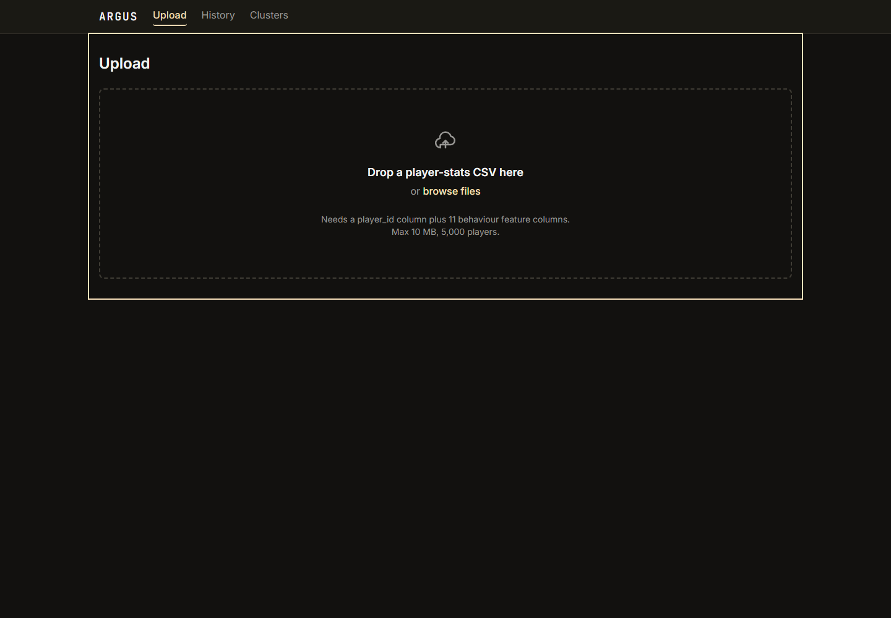
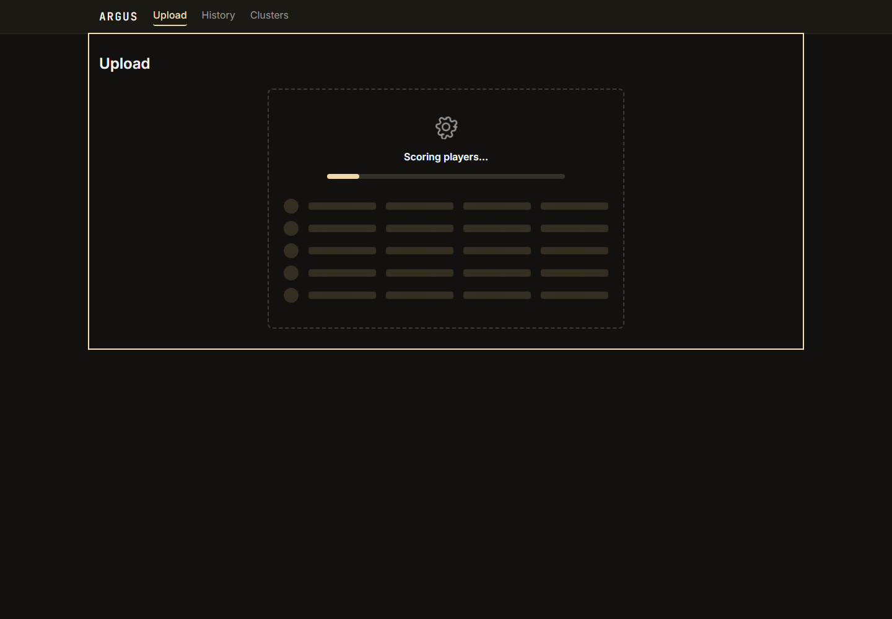
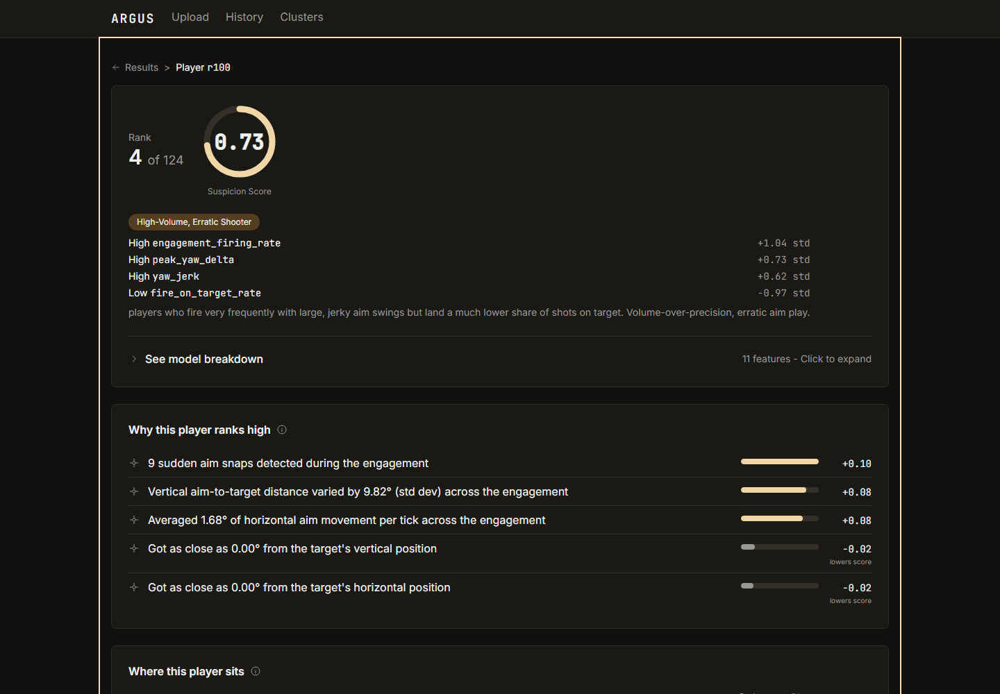
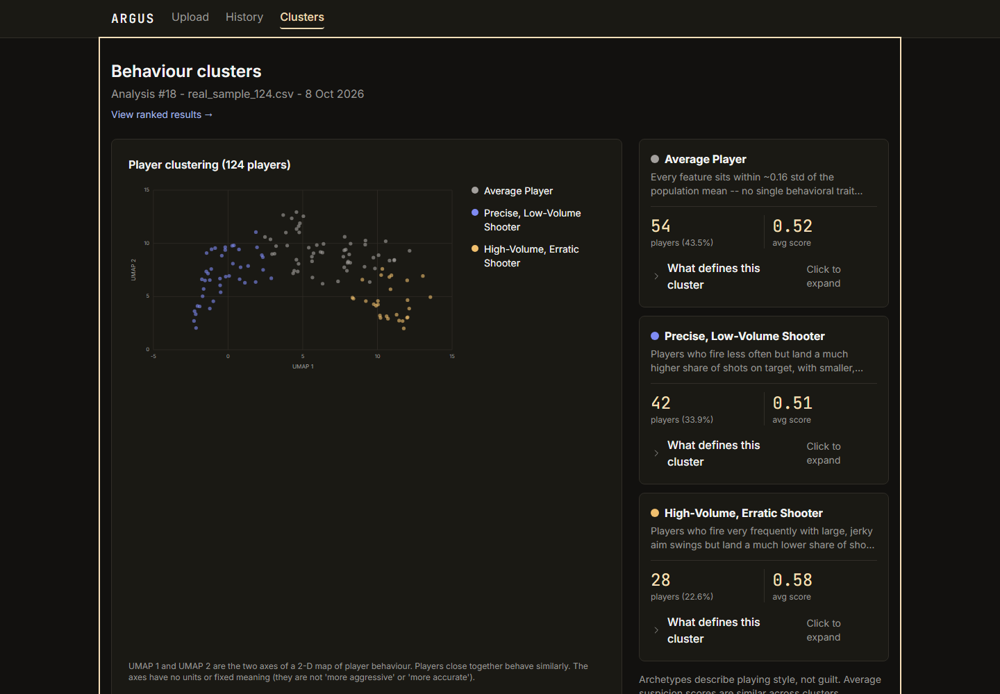
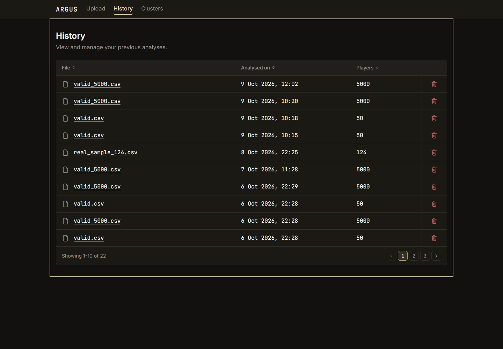
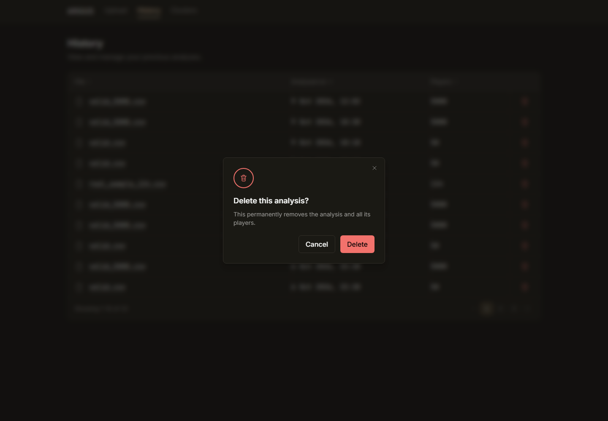
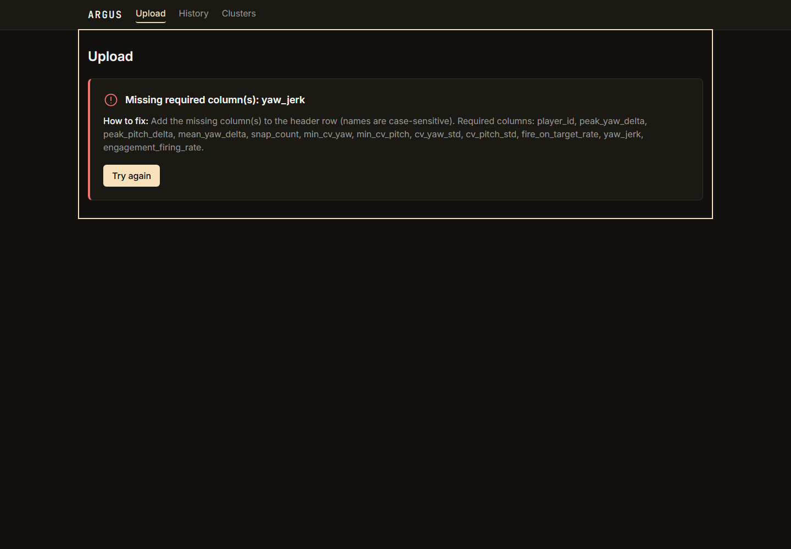

# ARGUS

**A**nomaly **R**ecognition and **G**ame **B**ehaviour **U**nderstanding **S**ystem — upload a CSV of per-player CS2 behaviour features and get back a ranked, explainable suspicion triage list, not a verdict.



## What it does

- Upload a CSV of per-player behaviour features; ARGUS scores and ranks every player by a **suspicion score** (0–1).
- Every player's rank can be opened for a **SHAP-based plain-language explanation** of why their score is what it is.
- Players are grouped into three behavioural **archetype clusters**, visualised on a 2-D UMAP map.
- Past uploads are kept in **History**, with delete.

## Honest results

ARGUS's deployed model is the **Isolation Forest + Autoencoder ensemble**, measured with AUC-ROC on an untouched test set: **0.6033** (`docs/PROJECT_LOG.md`, Phase 2.3's "Final ensemble AUC with corrected weight and model"). A **supervised Random Forest** trained on the same cleaned 11-feature set reached **AUC 0.6745** on the same test set — but that model was a *diagnostic reference only, never deployed* (`docs/PROJECT_LOG.md`, "FINAL WEEK 1 OUTCOME"). Both numbers come from the same held-out test split described there.

Plainly:

- **This is a triage tool.** It produces a suspicion score and a rank for human review — it does not render a verdict, and nothing in its output should be treated as proof of cheating.
- **Labels in the source training dataset are noisy.** Cheat labels are applied per-player across all of a player's engagements, even though the cheat behaviour is very unlikely to be active in every single one — a structural limitation documented in `docs/PROJECT_LOG.md`'s "FINAL WEEK 1 OUTCOME" and "Known, accepted limitation" notes.
- **Scores on out-of-range inputs can saturate near 1.0.** The scoring transform is a fixed-reference sigmoid calibrated against the training distribution (see Design decisions below); features far outside that distribution can push a score to the ceiling without that meaning "certainly cheating."
- **The bundled demo scores are not evidence of anything.** `sample_data/demo_players.csv` is 124 rows sampled directly from the model's own training data (see `sample_data/README.md`) — use it only to see the app working, never as a performance claim.

## Features

- Upload a CSV and get a ranked results page (podium + searchable, sortable, paginated table).
- Open any player for a SHAP explanation: the top features pushing their score up or down, in plain language.
- Browse behavioural archetype clusters on an interactive UMAP scatter plot.
- Review and delete past analyses from a History page.

## Architecture

### System



### Upload → analysis → player detail (lazy SHAP)



The offline training pipeline (feature engineering → cleanlab cleaning → Isolation Forest / Autoencoder training → K-Means/UMAP fit) is documented narratively, phase by phase, in `docs/PROJECT_LOG.md` rather than as a single committed pipeline script — no diagram is included here because that exact pipeline isn't captured in one verifiable place in the repo.

## Tech stack

| Layer | Package | Version (pinned) |
|---|---|---|
| Backend | fastapi | 0.141.1 |
| Backend | uvicorn | 0.53.0 |
| Backend | sqlalchemy | 2.0.54 |
| Backend | scikit-learn | 1.9.0 |
| Backend | torch | 2.12.0 |
| Backend | shap | 0.51.0 |
| Backend | umap-learn | 0.5.12 |
| Backend | pandas | 3.0.3 |
| Backend | numpy | 2.4.6 |
| Backend (train extra) | cleanlab | ≥2.9.0 |
| Frontend | react | ^19.2.8 |
| Frontend | react-router-dom | ^7.18.4 |
| Frontend | vite | ^8.3.0 |
| Frontend | tailwindcss | ^4.3.3 |
| Frontend | axios | ^1.20.0 |
| Frontend (dev) | oxlint | ^1.81.0 |

Versions above are from `uv.lock` (backend, exact pins) and `frontend/package.json` (frontend, declared ranges).

## Quick start

Requires Python ≥3.11 and [uv](https://docs.astral.sh/uv/), and Node for the frontend.

```bash
# Backend (from the repo root)
uv sync
uv run uvicorn main:app --reload --app-dir backend
# -> http://localhost:8000, GET /api/v1/health to check

# Frontend (separate terminal, from frontend/)
npm ci
npm run dev
# -> http://localhost:5173
```

Environment variables (both have a committed `.env.example`):

| Variable | Where | Default | Purpose |
|---|---|---|---|
| `VITE_API_BASE_URL` | `frontend/.env.local` | `http://localhost:8000/api/v1` | Where the frontend sends API requests |
| `LOG_LEVEL` | `backend/.env` or shell | `INFO` | `DEBUG` also logs per-request timing and SHAP cache hit/miss |

**Try it**: on the Upload page, drop in [`sample_data/demo_players.csv`](sample_data/demo_players.csv) (124 rows — see the caveat in [Honest results](#honest-results) and `sample_data/README.md`).

Training-only tooling (notebooks, retraining, `scripts/export_runtime_artifacts.py`) additionally needs `uv sync --extra train`.

## Upload format

A `.csv` with a header row containing `player_id` plus these 11 feature columns (`backend/core/model.py`'s `FEATURE_ORDER`; units/meaning as documented in `backend/core/explainer.py`'s `FEATURE_DESCRIPTIONS`):

| Column | Meaning |
|---|---|
| `peak_yaw_delta` | Largest single-tick horizontal aim snap, degrees |
| `peak_pitch_delta` | Largest single-tick vertical aim snap, degrees |
| `mean_yaw_delta` | Average horizontal aim movement per tick, degrees |
| `snap_count` | Count of sudden aim snaps during the engagement |
| `min_cv_yaw` | Closest horizontal approach to the target, degrees |
| `min_cv_pitch` | Closest vertical approach to the target, degrees |
| `cv_yaw_std` | Std. dev. of horizontal aim-to-target distance, degrees |
| `cv_pitch_std` | Std. dev. of vertical aim-to-target distance, degrees |
| `fire_on_target_rate` | Share of shots fired while aimed within 2° of the target |
| `yaw_jerk` | Average horizontal jerk (rate of change of aim speed), °/tick² |
| `engagement_firing_rate` | Share of ticks during the engagement with a shot fired |

Optional `*_source_engagement` / `*_source_tick` / `*_real_time_seconds` columns (for `peak_yaw_delta` and `min_cv_yaw`) add "(seen in engagement N, at Ts)" provenance to that feature's SHAP explanation when present.

Limits: `.csv` only, **10 MiB**, **5,000 rows** (`backend/core/config.py`, overridable via `ARGUS_MAX_UPLOAD_BYTES`/`ARGUS_MAX_ROWS`).

Every rejection is a 4xx with a plain-language `{code, message, fix}` body (`backend/api/routes/analyze.py`):

| Code | HTTP | When |
|---|---|---|
| `wrong_file_type` | 422 | Filename doesn't end in `.csv` |
| `file_too_large` | 413 | Upload exceeds the byte limit |
| `unreadable_csv` | 422 | Not valid UTF-8 comma-separated text |
| `no_rows` | 422 | Header row present, no data rows |
| `too_many_rows` | 422 | More rows than the limit |
| `missing_columns` | 422 | `player_id` or a feature column absent |
| `invalid_player_id` | 422 | A row has a blank/missing `player_id` |
| `invalid_values` | 422 | A feature cell is blank, non-numeric, or infinite |
| `duplicate_player_ids` | 422 | The same `player_id` appears more than once |

## API reference

All routes are under `/api/v1`.

| Method | Path | Purpose | Notable errors |
|---|---|---|---|
| GET | `/health` | Model/DB readiness check | — |
| POST | `/analyze` | Upload a CSV, create an analysis | see error table above |
| GET | `/history` | List past analyses, newest first | — |
| GET | `/history/{analysis_id}` | Reload one analysis (same shape as `/analyze`) | 404 `analysis_not_found` |
| DELETE | `/history/{analysis_id}` | Delete an analysis and its players/SHAP rows | 404 `analysis_not_found` |
| GET | `/player/{player_id}?analysis_id=` | One player's scores + (lazily computed, cached) SHAP explanation | 404 `analysis_not_found`, 404 `player_not_found` |
| GET | `/clusters?analysis_id=` | Per-archetype summaries + every player's UMAP point (defaults to the latest analysis if `analysis_id` is omitted) | 404 `no_analyses`, 404 `analysis_not_found` |

## Screenshots

| | |
|---|---|
|  Upload (idle) |  Processing |
|  Results |  Player detail (SHAP) |
|  Clusters |  History |
|  Delete confirmation |  Plain-language error |

## Project structure

```
ARGUS/
├── backend/
│   ├── api/          # FastAPI routes, Pydantic schemas, error shaping
│   ├── core/          # model.py, inference.py, clustering.py, explainer.py, config.py
│   ├── db/            # SQLAlchemy models, session, CRUD
│   ├── trained_models/ # committed model weights + the SHAP background artifact
│   ├── data/           # training fixtures (gitignored except via the export script)
│   ├── notebooks/      # Phase 1-3 research notebooks
│   └── tests/
├── frontend/
│   ├── src/
│   │   ├── pages/       # one file per route
│   │   ├── components/  # shared + page-scoped components
│   │   ├── api/          # backend client functions
│   │   ├── lib/          # pure helpers (dates, SHAP text parsing, cluster styling)
│   │   └── styles/       # tokens.css -- the only place colours are defined
│   └── public/
├── sample_data/        # demo_players.csv + its README
├── scripts/             # export_runtime_artifacts.py
└── docs/
    ├── PROJECT_LOG.md    # full phase-by-phase decision history
    ├── mockups/
    └── screenshots/
```

## Design decisions and limitations

- **Fixed-reference scoring**: raw model outputs are normalised against percentile bounds fixed at training time (`backend/trained_models/scoring_config.json`), not recomputed per upload — consistent scores across uploads, at the cost of saturating near 0/1 for inputs far outside the training distribution.
- **SHAP is lazy and cached**: `POST /analyze` never computes SHAP (it was the dominant cost at upload time); the first view of a given player computes it once (a few seconds) and every later view of that player is a cache read.
- **Training artifacts aren't in the repo**: the large raw per-tick arrays (`legit.npy`, `cheaters.npy`, the train/test splits) are gitignored. The one array the running backend actually needs — a deterministic 100-row SHAP background sample — is committed (`backend/trained_models/shap_background.npy`) and reproducible via `scripts/export_runtime_artifacts.py`.
- **`train` is an optional dependency group**: `cleanlab` (used only to rebuild the cleaned training split) is not a runtime dependency of the serving backend; install it with `uv sync --extra train` only if you need to retrain.
- **Runs locally; not deployed.** There is no hosted instance.

## Datasets and credits

Training data: a pre-processed Kaggle dataset of per-tick CS2 behaviour telemetry (see the dataset's own page for licensing — not recorded in this repo).

A second dataset, **CS2CD** (HuggingFace), was evaluated and excluded during initial scoping: inspected directly, it turned out to be raw, unlabelled, ~735M-row per-tick telemetry rather than the pre-windowed labelled dataset its source paper described, with no usable cheat labels in the public repo (`docs/PROJECT_LOG.md`, Phase 0). See the dataset's own page for licensing.
